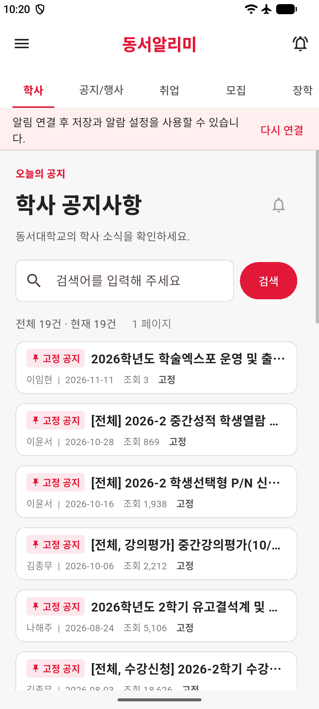
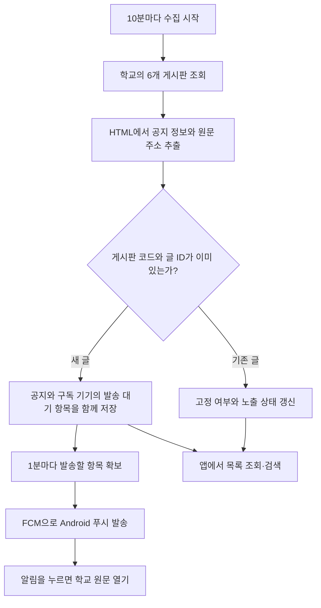

# 동서알리미 · DSU Notifier

**학교 홈페이지를 매번 열어보는 대신, 필요한 공지를 한곳에서 확인하고 새 소식을 알림으로 받습니다.**

동서알리미는 동서대학교의 주요 공지 게시판을 모아 보여주는 개인 사용 목적의 Android 앱입니다. 수강신청 일정, 장학금 신청, 채용 소식처럼 놓치기 쉬운 정보를 게시판별로 살펴보고, 관심 있는 게시판만 골라 알림을 받을 수 있습니다. 회원가입이나 Google 로그인 없이 설치한 기기를 등록해 사용합니다.

## 이런 순간을 위해 만들었습니다

“장학 공지가 올라왔는지 또 확인해야 하나?”

학교 소식은 여러 게시판에 나뉘어 있고, 필요한 공지가 언제 올라오는지 알기 어렵습니다. 동서알리미는 **확인하러 가는 일은 자동화하고, 읽고 판단하는 일은 사용자에게 남기는 것**을 목표로 합니다.

| 기존에 하던 일 | 동서알리미에서 하는 일 |
| --- | --- |
| 학교 홈페이지에서 게시판을 하나씩 찾아가기 | 앱 상단에서 게시판을 바꿔가며 확인하기 |
| 새 글이 있는지 반복해서 방문하기 | 관심 게시판의 새 공지를 푸시로 받기 |
| 나중에 볼 공지 링크를 따로 메모하기 | 별표로 저장하고 ‘저장된 공지’에서 다시 찾기 |
| 공지 제목을 보고 홈페이지에서 다시 검색하기 | 공지 카드를 눌러 학교 원문 열기 |

## 실제 실행 화면

Android 에뮬레이터에서 실행하고 실제 서버의 학사 공지 목록을 조회한 화면입니다. 상단에는 게시판 전환, 본문에는 검색창과 고정 공지 카드가 배치돼 있습니다. 공지 내용과 건수는 수집 시점에 따라 달라집니다.

  

캡처는 푸시 연결을 완료하기 전 상태여서 상단에 ‘다시 연결’ 안내가 표시됩니다. 목록 조회 화면을 촬영했으며, 알림 수신 화면을 보여주는 이미지는 아닙니다.

## 앱에서는 이렇게 사용합니다

1. **게시판을 고릅니다.** 학사, 공지/행사, 취업, 모집, 장학, 입찰 중 필요한 분야를 선택합니다. 고정 공지를 먼저 보여주고, 일반 공지는 최신 등록일 순으로 이어집니다.
2. **제목으로 찾습니다.** 검색어를 입력해 해당 게시판의 공지를 좁혀 봅니다. 다음 페이지로 이동하면 저장된 다른 공지도 확인할 수 있습니다.
3. **원문을 읽습니다.** 공지 카드를 누르면 외부 브라우저에서 학교의 상세 페이지가 열립니다. 본문과 첨부파일은 학교 원문에서 확인합니다.
4. **나중에 볼 공지를 남깁니다.** 일반 공지의 별표를 누르면 ‘저장된 공지’에 모입니다. 별표 저장은 푸시 알림 구독과 별개이며, 고정 공지에는 별표 버튼이 표시되지 않습니다.
5. **관심 게시판의 알림을 켭니다.** Android 알림 권한을 허용하고 게시판 제목 옆 종 버튼을 누릅니다. ‘알람설정’에서 구독 중인 게시판을 확인하고 끌 수 있습니다. 수신한 알림을 누르면 해당 공지의 원문으로 이동합니다.

예를 들어 장학 게시판의 종 버튼을 켜두면, 이후 새로 수집되는 장학 공지를 알림으로 받을 수 있습니다. 신청할 공지는 별표로 남겨두고 나중에 다시 확인하면 됩니다. 이미 저장돼 있던 공지를 구독 시점에 한꺼번에 보내는 방식은 아닙니다.

### 모아보는 소식

| 게시판 | 확인할 수 있는 소식의 예 |
| --- | --- |
| 학사 | 수강신청, 학적, 졸업 등 학사 일정과 안내 |
| 공지/행사 | 교내 공지와 행사 소식 |
| 취업 | 채용과 취업 지원 소식 |
| 모집 | 프로그램과 참여자 모집 |
| 장학 | 장학금 신청과 선발 안내 |
| 입찰 | 학교 입찰 공고 |

수집 대상 주소는 [게시판 목록](docs/dsu_url.md)에서 관리합니다. 컴퓨터공학부 게시판은 현재 수집 대상에 포함하지 않습니다.

## 새 공지가 알림이 되기까지

단순히 페이지를 다시 내려받을 때마다 알리는 방식이 아니라, **학교의 글 식별자로 새 공지를 구분하고 구독한 기기에만 발송**합니다.

### 1. 학교 목록을 읽고 정리합니다

수집기는 각 게시판의 HTML 목록에서 번호, 제목, 작성자, 등록일, 조회수와 원문 URL을 추출합니다. 다음 페이지 링크를 따라 **게시판당 최대 10페이지**까지 조회하므로 학교의 전체 과거 글을 모두 보관하는 서비스는 아닙니다.

번호가 없는 고정 공지는 번호를 억지로 만들지 않고 `null`로 저장합니다. 같은 글이 여러 페이지나 고정·일반 영역에 반복해서 등장하면 글 ID를 기준으로 합치고 고정 표시를 우선합니다. 원문 링크는 동서대학교의 허용된 HTTPS 주소인지 검사합니다.

### 2. 제목 대신 ‘게시판 코드 + 글 ID’로 새 글을 판단합니다

공지의 식별자는 원문 주소의 게시판 코드 `pCode`와 글 ID `idx`의 조합입니다. 제목이 같은 서로 다른 공지를 구분하고, 이미 수집한 글을 다시 읽어도 새 공지로 추가하지 않습니다.

예를 들어 `pCode=MN2000195`, `idx=12345`인 글을 다음 수집에서 다시 만나면 기존 글로 처리합니다. 이 조합에 DB 고유 제약을 두고, 같은 게시판을 동시에 저장하는 작업은 트랜잭션 잠금으로 직렬화합니다.

고정 공지는 성공적으로 수집한 목록에서 보이면 `importance_status = 'true'`, 더 이상 보이지 않으면 `'failed'`로 기록합니다. 여기서 `failed`는 글 삭제나 수집 실패가 아니라 **수집 범위에서 고정 노출을 확인하지 못했다는 상태**입니다. HTTP 요청이나 파싱이 실패하면 해당 게시판의 기존 데이터를 그대로 보존합니다.

### 3. 공지 저장과 알림 예약을 한 번에 처리합니다

새 공지가 DB에 들어오면 해당 게시판을 구독한 활성 기기별로 발송 대기열인 `notification_outbox`를 만듭니다. 공지와 대기 항목을 **하나의 트랜잭션**에 저장해, 공지만 저장되고 알림 예약이 빠지는 상황을 막습니다.

대기열에도 ‘공지 ID + 기기 ID’ 고유 제약을 적용합니다. 같은 공지를 다시 수집하거나 저장 작업을 재시도해도 동일 기기에 대한 발송 항목을 중복 생성하지 않습니다.

### 4. 발송 작업을 나눠 맡고, 결과에 따라 재시도합니다

발송기는 1분마다 대기열을 확인합니다. DB의 `FOR UPDATE SKIP LOCKED`로 항목을 확보해 여러 발송기가 같은 작업을 동시에 가져가지 않도록 하고, 발송 직전에도 기기의 활성 상태와 게시판 구독 여부를 확인합니다.

- 발송에 성공하면 완료 상태로 기록합니다.
- 재시도 가능한 서버 오류는 대기 시간을 늘리며 최대 3회 시도합니다.
- 더 이상 유효하지 않은 FCM 토큰은 비활성화합니다.
- 타임아웃처럼 FCM 수락 여부를 알 수 없는 경우에는 중복 알림을 피하기 위해 자동 재발송하지 않습니다. 따라서 모든 알림의 도착을 보장하지는 않습니다.

운영 기준은 **10분마다 수집, 1분마다 발송·재시도**입니다. 즉시 알림 방식은 아니며, 실제 도착 시각에는 수집·발송 시간과 네트워크, 기기의 절전·알림 설정이 영향을 줍니다.

## 화면과 시스템을 설계한 기준

**읽는 데 집중하는 화면.** 게시판 선택 → 검색 → 공지 목록 순서로 정보를 배치했습니다. 붉은 강조색은 선택한 게시판과 주요 동작에 사용하고, 공지 제목과 메타정보는 차분하게 구분합니다. 고정 배지는 제목 옆에, 별표는 별도 터치 영역에 둡니다. 색상 원본은 [colors.json](colors.json), 화면 구성 기준은 [디자인 시스템](docs/DESIGN_SYSTEM.md)에 있습니다.

**계정 대신 설치 기기.** 설치별 UUID와 인증 비밀값으로 기기를 구분합니다. 기기별로 게시판 구독과 저장 공지를 관리하며 계정 간·기기 간 동기화는 제공하지 않습니다. 서버 관리 키와 FCM 서버 인증정보는 앱에 포함하지 않습니다.

**본문은 학교 원문에서.** 앱은 공지를 발견하고 다시 찾는 역할을 맡습니다. 본문과 첨부파일을 별도로 복제하지 않고 학교 상세 페이지로 연결합니다.

| 구성 | 맡는 역할 |
| --- | --- |
| Flutter | 게시판 목록, 검색, 저장 공지, 알림 설정 화면 |
| Supabase Edge Functions | 학교 페이지 수집, 앱 API, 푸시 발송 |
| Supabase PostgreSQL | 공지·기기·구독·저장 상태와 발송 대기열 보관 |
| Supabase Cron | 수집과 발송의 주기적 실행 |
| Firebase Cloud Messaging | 등록한 Android 기기로 푸시 전달 |

## 현재 범위와 더 살펴볼 자료

Android 개인 설치를 우선합니다. iOS, 키워드별 알림, 학과별 게시판 확장, 사용자 계정과 기기 간 동기화는 현재 제공하지 않습니다. 메뉴에 ‘추후 예정’으로 보이는 항목은 사용 가능한 기능에 포함하지 않습니다.

설치용 APK는 로컬 빌드 산출물이며 이 README에서 공개 다운로드를 제공하지 않습니다. 직접 빌드하거나 운영 환경을 구성하려면 아래 문서를 참고하세요. 서버 설정 없이 실행하면 공지 목록을 불러올 수 없습니다.

| 궁금한 내용 | 문서 |
| --- | --- |
| 제품의 목표와 기능 범위 | [제품 기획서](docs/PRD.md) |
| 화면 구성과 컴포넌트 기준 | [디자인 시스템](docs/DESIGN_SYSTEM.md) · [컴포넌트](docs/COMPONENTS.md) |
| 데이터 구조와 처리 방식 | [기술 설계서](docs/TRD.md) · [API 명세](docs/API_SPEC.md) |
| 빌드, 환경 설정, 배포와 검증 기록 | [출시·운영 가이드](docs/RELEASE.md) |
| 기능별 확인 항목 | [테스트 케이스](docs/TEST_CASE.md) |

테스트·운영 프로젝트와 기기 토큰은 분리해 관리합니다. 환경 파일, Firebase 설정 파일, 서명 키와 서버 비밀값은 Git에 포함하지 않습니다.

## Google Play 비공개 테스트 준비

앱 콘텐츠·데이터 보안·스토어 설명·12명/14일 테스트·삭제 요청 운영 절차는 [Play Console 제출 가이드](docs/PLAY_CONSOLE_GUIDE.md)를 따른다. Play 업로드 파일은 `frontend/build/app/outputs/bundle/release/dsu-notifier-0.1.3-release.aab`다. 앱 메뉴 → 설정에서 개인정보처리방침·이용약관·데이터 삭제 안내를 오프라인으로 확인한다. 공개 정책은 운영 Supabase의 `/functions/v1/legal/privacy`, `/terms`, `/deletion`에 제공한다.
