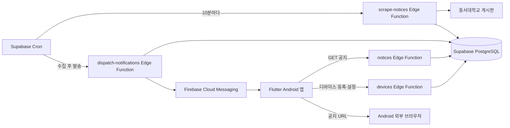

# 컴포넌트 문서

이 문서는 DSU Notifier의 실행 컴포넌트와 책임 경계를 설명한다. 운영 컴포넌트와 테스트 전용 코드를 구분하며, 구현되지 않은 API는 완료된 것으로 간주하지 않는다.

## 1. 전체 구조

운영 요청은 Supabase Edge Functions와 PostgreSQL에서 처리한다. `backend/`의 Node.js 코드는 운영 서버가 아니라 파서·저장소·알림·폴링 동작을 검증하는 테스트용 코어다.

## 2. 컴포넌트별 책임

| 컴포넌트 | 책임 | 주요 위치 |
|---|---|---|
| Flutter 앱 | 공지 표시, 알림 권한 요청, FCM 토큰 등록, 공지 URL 열기 | `frontend/lib/main.dart` |
| Flutter API Client | Edge Function HTTP 호출과 snake_case 응답 변환 | `frontend/lib/api_client.dart`, `frontend/lib/models/notice.dart` |
| Android Native Bridge | Android 13 알림 권한, 테스트 알림, 외부 브라우저 실행 | `frontend/android/app/src/main/kotlin/com/dsu/notifier/MainActivity.kt` |
| `notices` | 공개 공지 목록 조회와 게시판 필터 | `supabase/functions/notices/index.ts` |
| `devices` | 디바이스 등록·갱신, 게시판별 알림 설정, 비활성화 | `supabase/functions/devices/index.ts` |
| `scrape-notices` | 6개 게시판 수집, 파싱, 공지 upsert, 고정 상태 갱신, outbox 생성 | `supabase/functions/scrape-notices/index.ts` |
| `dispatch-notifications` | pending outbox 조회, FCM OAuth 인증, 발송 결과·재시도 기록 | `supabase/functions/dispatch-notifications/index.ts` |
| 공통 스크래퍼 | 게시판 목록, 허용 호스트 검사, HTML 필드 파싱, 중복 정규화 | `supabase/functions/_shared/` |
| PostgreSQL | 공지·디바이스·설정·outbox·수집 이력 저장 | `supabase/migrations/` |
| DB Function | 활성 디바이스별 outbox 생성과 중복 방지 | `enqueue_notice_notifications` |
| Supabase Cron | 수집과 발송 Edge Function의 주기 호출 | Supabase `pg_cron` + `pg_net` |
| Vault/Secrets | Cron 헤더, service role, FCM 서버 인증정보 보관 | Supabase Vault/Secrets |

## 3. 주요 실행 흐름

### 앱 시작과 디바이스 등록

1. Flutter 앱이 Android 알림 권한을 요청한다.
2. Firebase Messaging이 FCM 토큰을 발급한다.
3. `POST /devices/register`가 디바이스 식별자와 토큰을 upsert한다.
4. `PUT /devices/{device_id}/preferences`가 게시판별 알림 설정을 저장한다.
5. 앱은 `GET /notices`로 공지 목록을 조회한다.

앱에는 Supabase anon key만 포함한다. service role key와 FCM 서버 인증정보는 포함하지 않는다.

### 공지 수집과 저장

1. Supabase Cron이 `scrape-notices`를 10분마다 호출한다.
2. 함수가 `BOARDS`의 6개 게시판 첫 페이지를 요청한다.
3. 허용 호스트인 `www.dongseo.ac.kr`의 상세 링크만 파싱한다.
4. `(board_code, source_idx)`를 기준으로 `notices`를 upsert한다.
5. 새 공지에 대해 `enqueue_notice_notifications`를 호출한다.
6. 수집 성공·HTTP 실패·파싱 실패를 `scrape_runs`에 기록한다.
7. 수집 성공 시 최신 첫 페이지에 없는 기존 고정 공지를 `importance_status = failed`로 변경한다.

수집 요청이나 파싱이 실패한 게시판은 고정 공지 상태를 변경하지 않는다. 다른 게시판 수집은 계속한다.

### 알림 발송

1. `notification_outbox`에서 `pending`이며 3회 미만 시도한 항목을 조회한다.
2. FCM 서비스 계정으로 Google OAuth access token을 발급한다.
3. FCM HTTP v1 API로 제목·공지 URL·공지 식별자를 발송한다.
4. 성공 시 `sent`, 시도 횟수, 발송 시각을 기록한다.
5. 실패 시 시도 횟수를 증가시키고 3회 이후 `failed`로 기록한다.
6. FCM 401/404 응답은 해당 디바이스를 비활성화한다.

### 공지 열기

Flutter 항목 선택은 Android MethodChannel을 통해 `ACTION_VIEW`를 호출한다. 상세 공지 URL은 Android 외부 브라우저에서 열린다.

## 4. 데이터 책임과 불변식

### `notices`

- 원본 식별자는 `board_code + source_idx` 조합이다.
- 번호가 없는 고정 공지는 `number = null`이다.
- 고정 공지는 `is_notice = true`이며 현재 노출 상태는 `importance_status = true | failed`다.
- 일반 공지는 `importance_status = null`이다.
- `(board_code, source_idx)`는 unique다.
- 수집 실패는 기존 행을 삭제하거나 잘못된 값으로 덮어쓰지 않는다.

### `notification_outbox`

- 하나의 공지와 디바이스 조합은 하나의 행만 가진다.
- `(notice_id, device_id)`는 unique다.
- 발송 상태는 `pending | sent | failed`다.
- `attempts`는 발송 시도 횟수다.

### 디바이스와 설정

- `devices(device_id)`가 디바이스를 식별한다.
- 디바이스가 비활성화되면 새 outbox 대상에서 제외된다.
- `notification_preferences(device_id, board_code)`가 게시판별 알림 상태를 가진다.

## 5. API 경계

현재 구현된 앱 공개 API:

| Method | Path | 책임 |
|---|---|---|
| GET | `/notices` | 공지 목록과 `board_code`, `limit` 조회 |
| POST | `/devices/register` | 디바이스·FCM 토큰 등록 또는 갱신 |
| PUT | `/devices/{device_id}/preferences` | 게시판별 알림 설정 저장 |
| DELETE | `/devices/{device_id}` | 디바이스 비활성화 |

현재 구현된 내부 API:

| Function | 호출자 | 인증 |
|---|---|---|
| `scrape-notices` | Supabase Cron | `x-cron-secret` |
| `dispatch-notifications` | Supabase Cron | `x-cron-secret` |

`GET /notices/{id}`는 현재 Edge Function에 구현되어 있지 않다. `cursor` 파라미터도 현재는 응답에 `next_cursor = null`을 반환하므로 실제 페이지네이션을 제공하지 않는다.

## 6. 실패 처리와 운영 경계

- 게시판 HTTP 오류: 해당 게시판을 `http_failed`로 기록한다.
- HTML 파싱 오류: 해당 게시판을 `parse_failed`로 기록한다.
- 알림 발송 오류: outbox 시도 횟수와 마지막 오류를 기록한다.
- 중복 수집: DB unique 제약과 upsert로 중복 행을 막는다.
- 중복 알림: outbox unique 제약으로 같은 공지·디바이스의 중복 대상을 막는다.
- Cron 비밀값: 저장소가 아니라 Supabase Vault에 둔다.
- FCM 서비스 계정: Edge Function Secrets에만 둔다.

현재 운영에서 별도 확인할 항목:

- Cron 실행 이력은 Supabase Cron Jobs History에서 확인한다.
- 수집별 결과는 `scrape_runs`에서 확인한다.
- 발송 대기·실패·재시도는 `notification_outbox`에서 확인한다.

## 7. 테스트 경계

| 테스트 대상 | 방식 | 위치 |
|---|---|---|
| HTML 파서·저장소·폴링·알림 outbox | 고정 fixture와 단위 테스트 | `backend/__TEST__/` |
| Flutter API 역직렬화 | 가짜 JSON fetcher | `frontend/test/` |
| Flutter Widget | 가짜 데이터와 가짜 Client | `frontend/test/` |
| 실제 공지 URL | 외부 동서대학교 페이지 통합 확인 | 별도 통합 실행 |
| Edge Function·PostgreSQL | 테스트 Supabase 프로젝트 | 원격 통합 실행 |
| FCM·Android 권한·알림 탭 | 실제 Android 에뮬레이터 | 수동/통합 실행 |

운영 10분 주기와 테스트 러너의 30초 주기는 구분한다. 테스트용 공지와 디바이스 토큰은 운영 데이터와 분리한다.
